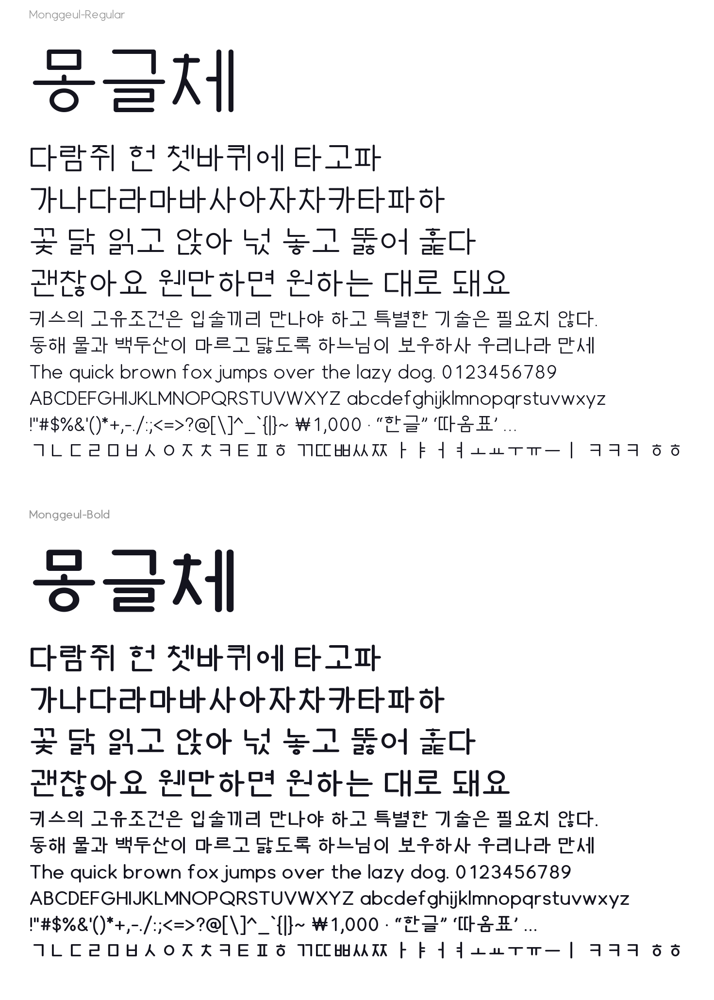

# 몽글체 (Monggeul)

둥근 모노라인 스타일의 한글 TTF 글꼴입니다. 글자 하나하나를 그린 것이 아니라
**획의 중심선(뼈대)** 으로 자모를 설계하고, 초성·중성·종성 배치 규칙으로
현대 한글 **11,172자 전부**를 자동 조합해 만듭니다.



## 파일

| 파일 | 용도 |
| --- | --- |
| `dist/Monggeul-Regular.ttf` | 보통 굵기 (설치용) |
| `dist/Monggeul-Bold.ttf` | 굵게 (설치용) |
| `dist/Monggeul-*.woff2` | 웹폰트 (같은 글꼴, 압축본) |

## 들어 있는 글자 (굵기마다 11,353개)

- 한글 음절 11,172자 (가 ~ 힣)
- 한글 낱자 51자 (ㄱ ~ ㅎ, ㅏ ~ ㅣ, 겹자음 포함): ㅋㅋㅋ, ㅎㅎ 같은 표현용
- 영문 대소문자, 숫자, ASCII 문장부호 전체
- 자주 쓰는 기호: `· … ‘ ’ “ ” – — • ° × ₩`, 원문자 `①` ~ `⑳`, 전각 공백

## 설치

- **Windows**: `.ttf` 파일을 우클릭하고 **설치**를 누릅니다.
- **macOS**: `.ttf` 파일을 더블클릭하고 서체 관리자에서 **설치**를 누릅니다.
- 설치하면 글꼴 목록에 **몽글체** (영문 환경에서는 *Monggeul*) 로 보입니다.

### 웹에서 쓰기

```css
@font-face {
  font-family: "Monggeul";
  src: url("/fonts/Monggeul-Regular.woff2") format("woff2");
  font-weight: 400;
  font-display: swap;
}
@font-face {
  font-family: "Monggeul";
  src: url("/fonts/Monggeul-Bold.woff2") format("woff2");
  font-weight: 700;
  font-display: swap;
}
body { font-family: "Monggeul", sans-serif; }
```

## 직접 고쳐서 다시 만들기

```bash
pip install -r font/requirements.txt
python3 font/build.py                    # dist/ 에 Regular·Bold 의 TTF·WOFF2 생성 (1분 이내)
python3 font/preview.py                  # preview.png 견본 다시 그리기
python3 font/preview.py --text "안녕하세요" --size 120 --out hello.png
```

이름을 바꾸려면 다음처럼 실행합니다. 파일 이름은 영문 이름을 따라갑니다.

```bash
python3 font/build.py --family-ko 내손글씨체 --family-en MyHand
```

### 어디를 고치면 무엇이 바뀌나

| 바꾸고 싶은 것 | 파일 / 위치 |
| --- | --- |
| 전체 굵기, 가로획 두께 비율 | `build.py` 의 `WEIGHTS` |
| 자음 모양 (ㄱ의 휘어진 다리, ㅅ의 갈래 등) | `hangul.py` 의 `_giyeok`, `_siot` … 함수 |
| 자음 크기 보정 (마·모·감의 ㅁ 크기 등) | `hangul.py` 의 `SCALE_L` / `SCALE_T` / `SCALE_F` |
| 모음 위치, 초성이 차지하는 폭 | `hangul.py` 의 `VSPEC`, `HSPEC`, `CSPEC` |
| 받침 높이, 위아래 간격 | `hangul.py` 의 `H_FINAL`, `C_FINAL`, `syllable()` 안의 받침 상자 |
| 영문·숫자·기호 | `latin.py` |
| 한글 글자 폭, 줄 높이 | `build.py` 의 `HANGUL_ADVANCE`, `ASCENT` / `DESCENT` |

자음 모양은 0~1 단위 상자 안의 짧은 경로 문자열로 적혀 있습니다.
예를 들어 ㄹ은 `"M0 1 L1 1 L1 .5 L0 .5 L0 0 L1 0"` 입니다
(`M` 이동, `L` 직선, `Q` 2차 곡선, `C` 3차 곡선, `Z` 닫기, y는 위쪽이 1).

## 만드는 방식

1. **틀 고르기**: 모음 모양에 따라 세 가지 틀이 있고, 각각 받침이 있을 때와 없을 때로 나뉩니다.
   - 세로 모음 (ㅏ ㅓ ㅣ …): 초성이 왼쪽에 옵니다.
   - 가로 모음 (ㅗ ㅜ ㅡ …): 초성이 위에 옵니다.
   - 섞임 모음 (ㅘ ㅝ ㅢ …): 초성이 왼쪽 위에 옵니다.
2. **자리별 자형**: 같은 ㄱ이라도 세로 모음 왼쪽(`가`)에서는 다리를 쓸어내리고,
   위(`고`)나 받침(`각`)에서는 곧게 내립니다. ㅁ·ㅂ·ㅎ 같은 자음은 자리에 맞게 크기를 줄입니다.
3. **굵기 맞춤**: 칸이 좁아 속공간이 막힐 것 같은 음절(`뚫`, `쀓`, 굵은 `빼` 등)은
   그 음절의 획만 조금 가늘게 합니다.
4. **획 칠하기**: skia-pathops 로 중심선을 둥근 끝·둥근 꺾임의 획으로 칠하고, 겹친 곳을 합칩니다.
   이때 가로획을 세로획보다 살짝 얇게 하는 납작한 펜을 씁니다 (Regular 94%, Bold 86%).
   같은 두께면 가로획이 더 굵어 보이는 착시를 보정하는 것입니다.
5. **조립**: fontTools 로 TrueType 윤곽(2차 곡선)으로 바꾸고 TTF·WOFF2 를 만듭니다.
   만든 파일은 OpenType Sanitizer(브라우저가 웹폰트를 검사할 때 쓰는 도구) 검사를 통과합니다.

## 알아 둘 점

- **힌팅이 없습니다.** 요즘 화면(맥, 고해상도 윈도, 모바일)에서는 문제없습니다.
  다만 오래된 윈도의 아주 작은 글자에서는 흐릿하게 보일 수 있습니다.
  이를 줄이려고 `gasp`·`prep` 테이블을 넣어 두었습니다.
- 옛한글과, 첫가끝 조합형 자모(U+1100 블록)는 들어 있지 않습니다.
  macOS 파일 이름처럼 자모가 분리된(NFD) 문자열은 다른 글꼴로 대체되어 보일 수 있습니다.
- 한글·영문 모두 직접 만든 설계이므로 저작권은 만든 사람(여러분)에게 있습니다.
  다른 사람에게 배포하려면 [SIL Open Font License](https://openfontlicense.org) 같은 글꼴 라이선스를 붙이는 것을 권합니다.
